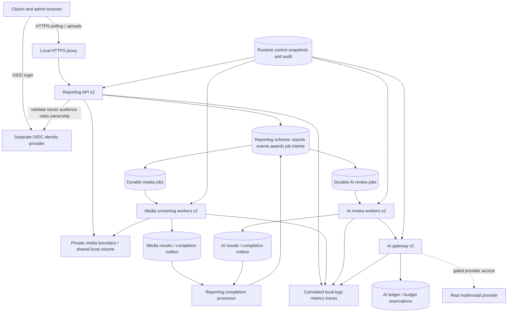

# Architecture Proposal — initial-build

Status: **Approved by user on 2026-10-24.** Approval covers the four review decisions below, including AP-D01–AP-D06. Proposal/pending labels in the document describe its pre-review presentation and are superseded by this approval. No Plan, contract, executable implementation, paid provisioning, or live AI spending is approved by architecture approval. Live AI remains disabled until a separate currency, cap, and accounting period are approved.

## Authority and inspected baseline

The approved `requirements.md` is authoritative, including IB-R01–IB-R20 and IB-AC01–IB-AC17. Its Q24–Q26 values remain unapproved. This proposal makes those choices concrete for review without changing requirements. Exact API/schema/status/retry/configuration semantics belong to the later CONTRACT milestone after Plan approval.

Inspected files: `README.md` and `docs/.ai/initial-build/requirements.md`. The current checkout contains documentation only: no application, build manifest, executable startup scripts, database, or tests. No repository AGENTS.md, CLAUDE.md, or copilot-instructions.md was found. README implementation claims describe a documentary baseline, not verified behavior; its SQLite, in-process tasks, placeholder identity, and shared reviewer token are unsuitable for the approved multiple-instance and authentication requirements. The approved requirements supersede those baseline choices for this work item.

Design guidance read: production-engineering-standards `prompt-driven-development/SKILL.md`, `architecture-design/SKILL.md`, and `architecture-design/references/capability-boundaries.md`. This is an architecture-review input, not a PDD Plan or external contract.

## Recommended architecture, pending approval

Use Python with FastAPI for APIs and worker application code, PostgreSQL for transactional state and durable jobs, a private local filesystem volume accessed only through the media boundary, and a small browser UI served behind a local HTTPS reverse proxy. Use PostgreSQL jobs rather than adding a message broker for the demo. Use an independently deployed OIDC identity provider (recommended Keycloak with local demo accounts) for the separate authentication boundary. Keep all AI provider credentials and calls in a separate AI gateway. Pin supported dependency/container versions in a subsequently reviewed FOUNDATION Implementation Plan; no versions or installations are established here.

Organize a reporting application into explicit reporting, review/award, and configuration administration modules; run media screening and advisory AI review as separate worker roles. This balances a small codebase with independent resource limits and responsibilities. Do not split every domain table into a service. Use business-facing adapters for private media access and AI access because local/test and provider behavior differ materially. Avoid wrappers that only rename a framework call.

### Local topology

Recommend portable Compose configuration for a single developer machine: one HTTPS reverse proxy; two reporting API processes; two media workers; two AI review workers; two AI gateway processes; one OIDC provider; one PostgreSQL server; a private media volume; and local telemetry collection. Browser traffic enters through HTTPS on loopback with a locally trusted development certificate. Internal endpoints bind to the private container network; no public exposure or cloud resources. The proxy balances stateless API replicas; requests need no sticky sessions. Resource limits must keep malformed video decoding from exhausting reporting capacity.

This satisfies a testable multiple-application-instance topology, **not** host-level high availability: PostgreSQL, authentication, proxy, media disk, and the machine remain single failure domains. CPU/RAM/disk availability on the actual machine must be measured before benchmark claims. Running fewer replicas during ordinary development must not replace the two-instance acceptance demonstration.

Database boxes may be schemas/tables in the same PostgreSQL deployment. Arrows describe logical responsibility and durable handoffs, not permission for one service to update another service's business tables. APIs/workers verify tokens locally using issuer keys with bounded caching; the authentication arrow does not imply synchronous login validation on every poll. Signing-key cache expiry and outage handling require CONTRACT review.

### Ownership and interactions

| Boundary | Owns | Permitted interactions |
|---|---|---|
| Authentication | Credentials, identity lifecycle, citizen/admin roles, token issuance | Browser login; signed tokens verified by services; application stores stable subject references, never passwords |
| Reporting | Reports, citizen ownership, clarification rounds, timeline, final human decisions, awards, report status projections | Authorized HTTPS operations; creates durable stage jobs; consumes stage completions; sole writer of decisions/awards |
| Media screening | Original evidence catalog, global hash registry, quarantined/private bytes, technical results, derivatives | Authorized ingest/access capability; bounded decoding workers; emits technical completion; cannot approve or award |
| AI review | Advisory assessment, review attempt/result provenance | Consumes eligible stage jobs, obtains scoped derivative access, calls gateway, emits advisory completion |
| AI gateway | Provider adapter, provider credentials, usage/error ledger and budget enforcement | Authenticated AI-review callers only; approved provider/model and structured responses; never finalizes report |
| Runtime controls | Versioned operational settings and administrative audit | Narrow management interface; consumers read approved published snapshots; no direct browser/database writes |

Use separate database roles/schema ownership, explicit command/result payloads, and narrow grants. A durable stage job created in the reporting transaction can carry a report/evidence revision and immutable input reference. Completion is written with its outbox entry in the result owner's transaction; a reporting-owned consumer applies it idempotently. This avoids distributed transactions. Authentication provider schema is separate from application schemas.

Proposed workflow: accept report and evidence references, screen media, perform advisory AI review when enabled, then await admin action. Invalid media or exhausted processing is visible with reason; AI exhaustion leaves manual review available. More-information requests create a new clarification round; text and/or new evidence can return it to processing/review. A completion for an older round cannot overwrite current state. Final approval/rejection is immutable. Exact states and permitted transitions are intentionally deferred to CONTRACT.

## Correctness under concurrency and failures

### Durable work

Recommend transactional outbox/job intent creation with the report mutation; job uniqueness on stage, report, evidence revision, and round. Workers claim jobs using short PostgreSQL row-lock transactions with `SKIP LOCKED`, persist a lease deadline and increasing fencing token, and perform slow decoding/provider work outside the claim transaction. Heartbeats renew leases; crashed workers' expired leases become claimable. A stale worker cannot publish an authoritative completion without the current fencing token. Stage results and completion events have unique logical keys; reporting applies each completion once and checks expected report revision.

Delivery is at least once; it is not exactly-once external execution. Retryable failures, backoff, maximum attempts, lease/timeout limits, and manual recovery are CONTRACT decisions. Proposed retry candidates are timeouts, transient connection failures and throttling; unsupported/corrupt media and invalid payloads should not loop. Exhausted jobs stay inspectable with sanitized error and timeline status. Replaying an exhausted job requires explicit authorization and a new auditable attempt/revision; it must not reopen a final report.

### Global identical-evidence rejection

Compute SHA-256 from original uploaded bytes while enforcing streaming limits. A unique constraint on the global hash registry arbitrates simultaneous submissions by different API instances, citizens and clarification rounds. Keep hash identity independent of report status. Reserve hash and immutable evidence ID, store a staged private object, and finalize it through a recoverable protocol; never claim a filesystem write and SQL commit are atomic. Pending reservations have bounded recovery and cleanup; a retry by the same ingest operation resolves its pending result, while a distinct upload gets the reviewed duplicate/conflict result. Final report/job publication requires a finalized media object; orphaned bytes/reservations are reconciled after crashes.

Whether rejected/abandoned uploads permanently retain a hash, retention/deletion implications, and pending-conflict responses must be explicit CONTRACT decisions. Recommend retained hashes for accepted originals and clarification evidence throughout the demo, and releasing only failed pre-acceptance reservations after reconciliation. No perceptual similarity or authenticity guarantee is inferred from a hash. Cross-citizen duplicate errors must not reveal the original uploader/report.

### Human decision and awards

Reporting performs conditional finalization under a row lock or expected-version update. In one PostgreSQL transaction: verify current reviewable round and authorization, append the final decision and timeline event, and insert the award for approval. Enforce a unique final decision per report and unique award per report in the database. Concurrent approve/reject attempts have one winner; losing/conflicting requests cannot award. An idempotency key resolves a repeated successful request without a second mutation. Point totals derive from the award ledger (or a transactionally maintained projection), not a read-increment-write counter. Persist category/rate applied: helmet 2, triple riding/red-light 3 provisional points. No model result can invoke finalization.

### Media and access

Store originals immutable under generated keys, outside static web roots; never trust filenames, extension or claimed MIME alone. Screen signatures/container readability and approved duration/size limits in a bounded low-privilege decoding process with time, memory and subprocess limits. Reporting supplies scoped media capabilities; citizens access only their own evidence and authorized admins can access originals/export. A ZIP export streams the original bytes, matching hash and consistent timeline snapshot; export access is audited. No public media URL or credential appears in logs. Concrete limits, authentication failure responses, export behavior and role mapping await CONTRACT review.

## Both control tables

### Planning and approval record

This document's table complements the approved requirements' Architecture Control Table. It tracks proposals, owner and approval evidence; it never publishes runtime settings. After human review, record the user's decision in the appropriate subsequent authorized artifact without rewriting approved requirements silently.

| Proposal ID | Proposed decision | Existing approval | Decision needed |
|---|---|---|---|
| AP-D01 | Python/FastAPI, PostgreSQL durable jobs, private media boundary, separate OIDC auth and AI gateway | Responsibility requirements only | Accept stack, boundaries and correctness approach |
| AP-D02 | Local Compose topology with two replicas of application/worker/gateway roles | Multiple instances required; hosting unselected | Accept local target and single-host limitations (Q25) |
| AP-D03 | 1M synthetic accounts, 100 active users, 10 uploads/minute for 30 minutes | 1M account design only | Accept benchmark workload/evidence scope (Q24) |
| AP-D04 | No paid hosting/provisioning; live AI calls disabled pending approved currency/cap/period | No budget approved | Accept zero-paid initial mode (Q26); live spending remains unapproved |
| AP-D05 | Thirty-day media-growth planning scenario below, not retention policy | No growth horizon approved | Accept scenario as sizing input, not storage commitment |
| AP-D06 | Versioned runtime controls below; exact contract later | Database-backed runtime controls required | Accept design direction; details stay CONTRACT decisions |

### Proposed database-backed runtime controls

Recommend typed allowlisted settings stored as atomic published configuration snapshots: revision, schema version, effective time, values, actor, reason, validation result and created time. Keep append-only audit records with old/new values and expected revision; never store secrets in this table. A settings administrator permission is distinct from ordinary review permission. Require authenticated management commands, validated types/ranges and cross-field constraints, optimistic concurrency, and explicit publish. Invalid or conflicting edits are rejected without partial updates. Do not make point rates or immutable upload limits runtime-editable initially; those encode approved behavior.

| Setting group | Proposal | Validation / failure behavior |
|---|---|---|
| AI enablement and spend policy | Default disabled; no approved currency, cap or period exists | Enabling requires all budget fields, approved provider/model, credentials and permission; absent/invalid state blocks live calls |
| AI concurrency/timeouts | Bounded operational limits | Positive bounded values; gateway checks fresh revision before dispatch; hard upper bounds in reviewed contract |
| Worker attempts/backoff/lease | Runtime-editable after CONTRACT approval | Lease exceeds heartbeat/operation relationships; bounded attempts; retry classification remains reviewed policy |
| Polling operational interval | Nominal 10 seconds, bounded jitter up to 2 seconds | Must retain enough response/render margin to meet 30 seconds; cannot publish an interval violating the freshness contract |

Recommend snapshot polling every five seconds for ordinary controls, exposing each instance's observed revision and age. Consumers validate a complete snapshot and swap it atomically. A control outage permits a last-known-valid ordinary snapshot for a proposed 60 seconds; after that stop new affected work, report degraded health, and leave durable jobs recoverable. Reject management writes during database outages. Jobs persist the relevant policy revision; ordinary changes apply to newly claimed jobs, while already claimed work follows its recorded revision. Exact propagation and stale-age bounds need CONTRACT approval.

**Safety-sensitive AI enablement and budget are different:** gateway dispatch checks current database policy and reserves funds transactionally for every live request; no stale cached authorization or budget decision permits spend. Concurrent gateway instances reserve against the same cap and accounting period before dispatch. Missing policy/database access, expired period or insufficient allowance blocks calls. In-flight calls may complete after a disable; their reservations remain accounted. Retry attempts require separate reservations unless provider idempotency is verified. Unknown provider outcomes retain conservative reservations for reconciliation, rather than releasing funds and spending again. Reserve an approved worst-case amount using bounded input/output and a versioned price schedule; if an enforceable upper bound cannot be established, keep calls disabled. Do not promise the gateway can undo provider charges or prevent out-of-band account usage.

AI-disabled runs must clearly display that no live AI assessment occurred and permit the reviewed manual path. Test substitutes are explicitly labeled and confined to tests/benchmark, never portrayed as real AI. Completing a live integration demonstration remains pending separate budget approval and controlled provider evidence; provider-free tests alone cannot establish IB-AC01/IB-AC05 live-provider behavior.

## Polling and observability

Propose authorized citizen status/timeline polling every 10 seconds with up to 2 seconds bounded jitter, one request in flight, revision/ETag support and immediate refresh on page focus. Read committed status from PostgreSQL without a stale replica cache. The 30-second active-page freshness requirement includes poll wait, API response and rendering, not just server persistence. Validate end-to-end timestamps under the agreed healthy-connectivity load. Hidden/offline pages show reconnection state; no false freshness promise. At 100 active pages, the nominal baseline is roughly 10 polls/second before other requests; measure rather than extrapolate to 1M simultaneous users.

Propagate correlation and trace identifiers through HTTPS, job payloads, attempts, gateway calls and completion events; retain report/evidence IDs only where appropriate. Structured logs exclude tokens, original media and unnecessary personal data. Measure queue depth/oldest age, job attempts/lease recovery, processing duration/failure, AI request latency/tokens/cost/reservations/errors, status freshness, authorization failures, duplicate races, admin decisions, award constraint conflicts, and config revision age. Use local structured logging, OpenTelemetry-compatible tracing and metrics collection; choose exact collection packages during FOUNDATION planning. Admin/report timeline remains durable business audit rather than a substitute for operational telemetry. Alert thresholds, telemetry retention and redaction verification belong to the observability Implementation Plan, as required by Q22; none are approved here.

## Capacity and media estimates for review

Propose a repeatable 30-minute synthetic benchmark with **1,000,000 seeded accounts, 100 concurrent active users and 10 uploads/minute** (300 uploads), matching Q24's existing proposal. Seeds use non-sensitive identities. Distinct staged originals avoid accidentally benchmarking only duplicate rejection. Include separately counted duplicate and clarification scenarios; record whether these are additional to the 300 uploads. Use the explicitly labeled AI substitute, configured with recorded latency/failure profiles. Report live-provider capacity as untested.

Measure registration/history lookup behavior at 1M rows, HTTPS latency distributions, active-page freshness, queue age/drain time, decoder CPU/RAM, PostgreSQL locks/query plans, connection counts, disk growth and throughput. Record machine hardware, storage, replica counts, dataset/category/media mix, test tool versions and warmup policy. Fault probes cover worker termination/reclaim and concurrent reviewers; do not mix injected faults into healthy-connectivity freshness results without labeling them. Approved invariants must hold; results against proposed latency expectations are measurements until CONTRACT/Plan defines additional pass criteria. A single machine run does not prove production availability or future geographic scale.

Sizing estimates, explicitly **not promises or retention rules**:

| Input/scenario | Arithmetic / implication |
|---|---|
| 300 original files at assumed 5 MB average | About 1.5 GB originals for the benchmark, before derivatives/database/backups |
| 300 files at 25 MB each | About 7.5 GB originals as an approximate upper scenario; exact MB semantics await CONTRACT |
| Sustained 10/minute for 24h | 14,400 originals/day; at assumed 5 MB, about 72 GB/day |
| Same sustained load for proposed 30-day horizon | 432,000 originals; about 2.16 TB originals; at 25 MB, about 10.8 TB |
| 1M account rows at assumed 1–2 KB logical data each | About 1–2 GB logical account data, excluding indexes, identity-provider storage, PostgreSQL overhead and backup/WAL |

Use decimal estimates for readability, not exact acceptance boundaries. Clarification attachments increase file count; video derivatives, thumbnails, WAL, temporary quarantine, exports, identity records, telemetry and backups add storage. Plan an initial measurement envelope of roughly 2–3 times originals for local free-space checking, then replace it with measured sizes; this factor is an assumption, not a guarantee. Sustained daily load is a stress scenario, not inferred demand. A laptop should run the finite benchmark, not provision a month of continuous peak evidence. Retention/deletion and legal production policy remain outside this controlled staged-data proposal and must be resolved before real data use.

## Tradeoffs and evidence needed

PostgreSQL jobs reduce components and give transactional handoffs; workers must still implement leases, backpressure and idempotency, and database contention may later justify a broker. A single PostgreSQL deployment with logical ownership is cheaper to operate locally than separate databases, but has shared resource/failure exposure. Local private storage avoids paid object storage and requires only same-host access; moving to multiple hosts requires a reviewed shared object-store adapter and durability/backup design. Separate authentication adds operational weight but meets the approved boundary and avoids inventing password security. Independent AI gateway processes centralize spend and provider isolation but cannot guarantee model accuracy. Python suits media/provider work; subprocess isolation and actual load evidence are necessary for CPU-heavy decoding.

Required later evidence includes: global duplicate races across API replicas and clarification uploads; conflicting and replayed final decisions with one award; atomic outbox and recovery across crash windows; expired-worker fencing; stale-round completion rejection; screening retry/exhaustion/manual review; role and ownership denial including export; media format/size/duration boundaries; configuration audit/concurrent edits/propagation/outages; concurrent budget reservations and unknown-provider outcomes; provider-free CI with network denial; polling freshness under the reviewed benchmark; and correlation through every stage. These are proposals for traceable Plan ownership, not tests run today. No source, build, service, benchmark, provider call or deployment exists or was executed in this architecture step.

## Exact review decisions requested before Plan preparation completes

1. Approve AP-D01/AP-D02: the recommended stack and local multiple-instance topology, with its single-host limitations and no public deployment.
2. Approve AP-D03/AP-D05: the Q24 synthetic benchmark and the explicitly estimated 30-day growth scenario as planning inputs, with no production-capacity promise.
3. Approve AP-D04: no paid provisioning/hosting and live AI disabled until a separate currency, cap and accounting period are approved. This permits external-free development; the live-provider demonstration stays gated.
4. Approve AP-D06 and the proposed correctness/control direction for Plan drafting; retain exact runtime semantics, retries, APIs and media limits for the first CONTRACT milestone.

Review state: user accepted all four architecture review decisions on 2026-10-24. The next artifact is a proposed Plan with explicit requirement/acceptance ownership, CONTRACT first, conditional FOUNDATION prerequisites, independently reviewed RED/GREEN milestones and observability decision ownership. Architecture acceptance does not approve that Plan or executable changes.
