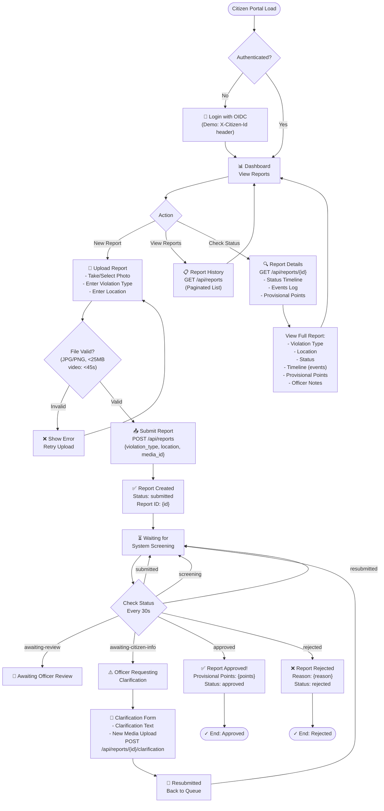
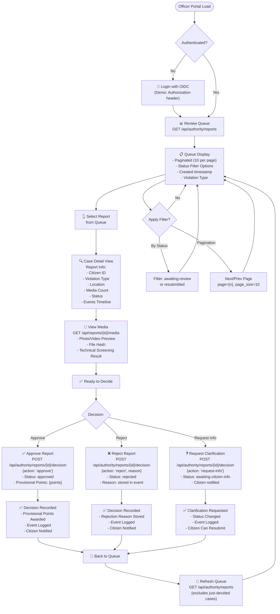
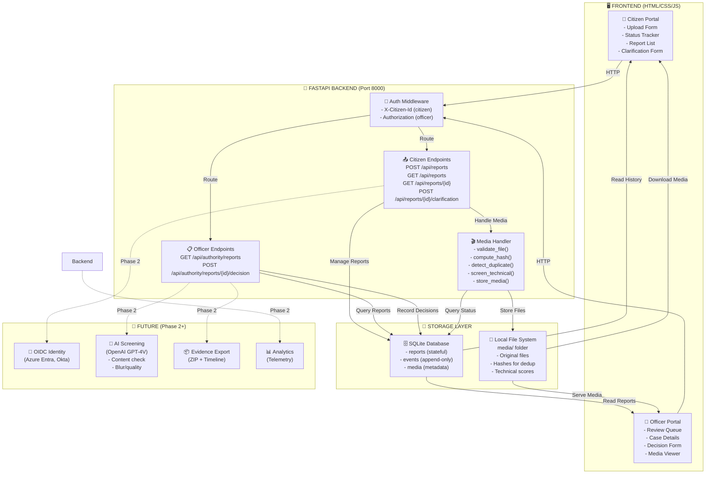
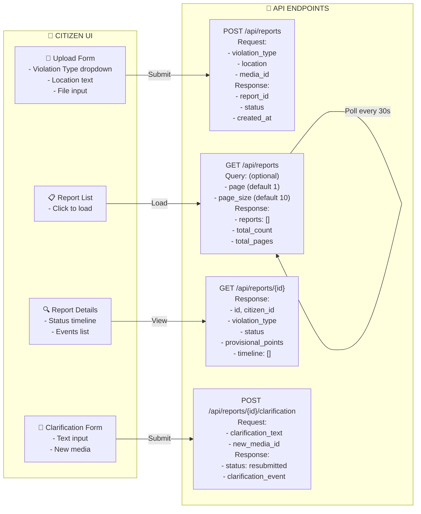
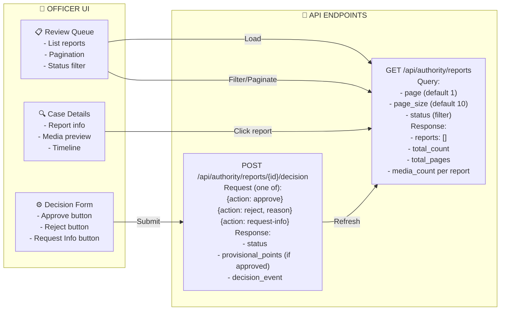
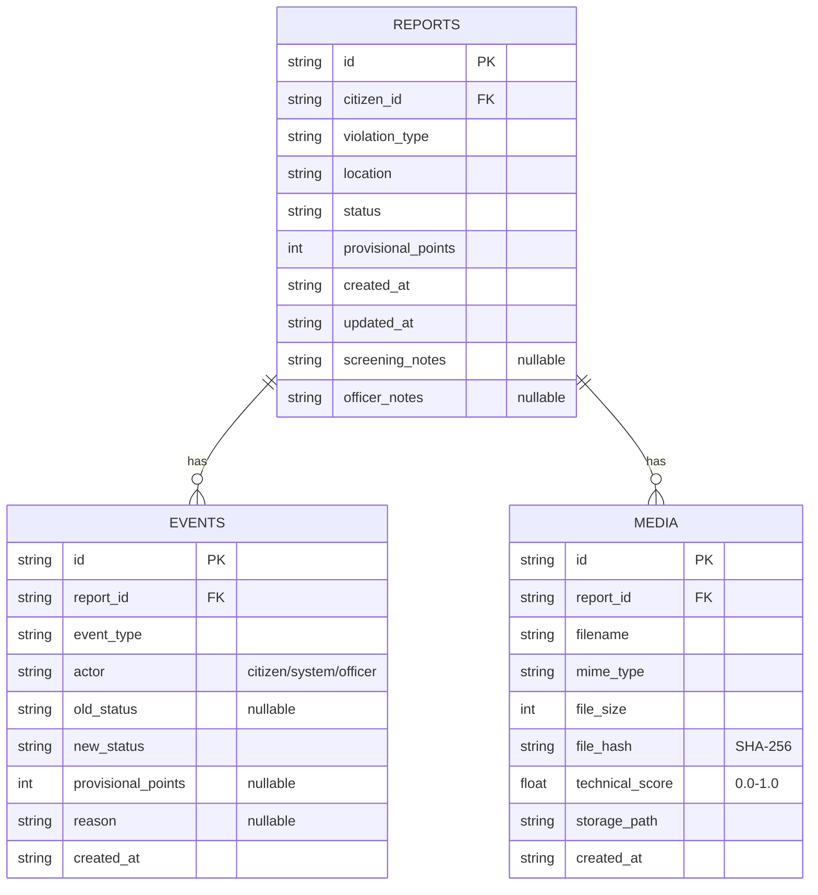
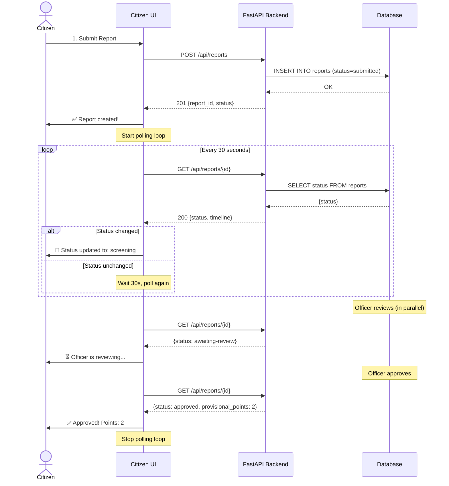
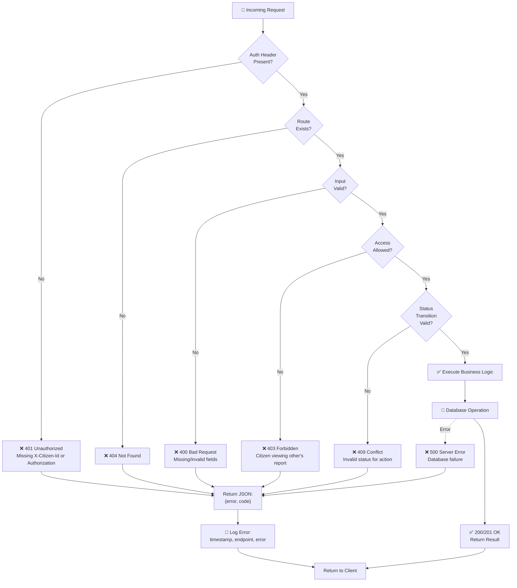

# RoadWatch Architecture & Flow Diagrams

## 1. CITIZEN WORKFLOW — Complete User Journey



---

## 2. OFFICER WORKFLOW — Authority Review & Decision



---

## 3. SYSTEM ARCHITECTURE — Components & Data Flow



---

## 4. DATA MODEL — Report Lifecycle State Machine

```mermaid
stateDiagram-v2
    [*] --> submitted: 1. Citizen submits report<br/>POST /api/reports
    
    submitted --> screening: System processes<br/>(Optional: AI screening)
    
    screening --> awaiting-review: Ready for officer
    
    awaiting-review --> approved: 2a. Officer approves<br/>POST decision {approve}
    awaiting-review --> rejected: 2b. Officer rejects<br/>POST decision {reject}
    awaiting-review --> awaiting-citizen-info: 2c. Officer requests info<br/>POST decision {request-info}
    
    awaiting-citizen-info --> resubmitted: Citizen responds<br/>POST /api/reports/{id}/clarification
    
    resubmitted --> awaiting-review: Back in queue<br/>for re-review
    
    approved --> [*]: ✅ FINAL: Provisional points awarded
    rejected --> [*]: ❌ FINAL: Rejected, citizen can appeal
    
    note right of awaiting-review
        Officer sees: reports with status
        IN (awaiting-review, resubmitted)
        Sorted by created_at (FIFO)
    end note
```

---

## 5. API INTEGRATION MAP — Frontend to Backend

### **CITIZEN PORTAL API CALLS**



### **OFFICER PORTAL API CALLS**



---

## 6. DATABASE SCHEMA — Quick Reference



---

## 7. UI PAGE LAYOUT MAP

```
CITIZEN PORTAL
├── /dashboard (default)
│   ├── Welcome message
│   ├── [+ New Report] button
│   └── Recent reports summary
│
├── /upload
│   ├── Violation Type dropdown
│   ├── Location input
│   ├── File upload widget
│   ├── Submit button
│   └── [View My Reports] link
│
├── /reports (list)
│   ├── Search/filter bar
│   ├── Report table:
│   │   ├── Report ID (clickable)
│   │   ├── Violation Type
│   │   ├── Status badge
│   │   ├── Created date
│   │   └── Action (view)
│   ├── Pagination controls
│   └── [+ New Report] button
│
└── /reports/{id}
    ├── Report header (ID, status, points)
    ├── Report details
    │   ├── Violation Type
    │   ├── Location
    │   ├── Media count
    │   └── Created timestamp
    ├── Timeline/Events section
    │   └── Event cards (status changes, officer actions)
    ├── Conditional sections:
    │   ├── [Clarification Form] if status=awaiting-citizen-info
    │   └── [Final Verdict] if status=approved/rejected
    └── [Back] link

OFFICER PORTAL
├── /queue (default)
│   ├── Status filter (awaiting-review, resubmitted)
│   ├── Report table:
│   │   ├── Report ID (clickable)
│   │   ├── Citizen ID (masked)
│   │   ├── Violation Type
│   │   ├── Location
│   │   ├── Status
│   │   ├── Media count
│   │   └── Submitted time
│   ├── Pagination (page/page_size)
│   └── [Refresh] button
│
└── /queue/{id} (case detail)
    ├── Case header
    │   ├── Report ID
    │   ├── Status badge
    │   ├── Violation Type
    │   └── Media count
    ├── Report Details
    │   ├── Citizen ID (masked)
    │   ├── Location
    │   ├── Created timestamp
    │   └── Description (if any)
    ├── Media Section
    │   ├── Photo/video viewer
    │   ├── File hash (for audit)
    │   └── Technical score (if screened)
    ├── Timeline/Events
    │   └── All events (citizen uploads, status changes, etc.)
    ├── Decision Section
    │   ├── [✅ Approve] button
    │   ├── [❌ Reject] + reason field
    │   └── [❓ Request Info] button
    └── [Back to Queue] link
```

---

## 8. HEADER DEFINITIONS & AUTHENTICATION

### **Request Headers Required**

| Endpoint | Auth Header | Example |
|---|---|---|
| `POST /api/reports` | `X-Citizen-Id` | `X-Citizen-Id: citizen-abc123xyz` |
| `GET /api/reports` | `X-Citizen-Id` | `X-Citizen-Id: citizen-abc123xyz` |
| `GET /api/reports/{id}` | `X-Citizen-Id` | `X-Citizen-Id: citizen-abc123xyz` |
| `POST /api/reports/{id}/clarification` | `X-Citizen-Id` | `X-Citizen-Id: citizen-abc123xyz` |
| `GET /api/authority/reports` | `Authorization` | `Authorization: Bearer demo-token` |
| `POST /api/authority/reports/{id}/decision` | `Authorization` | `Authorization: Bearer demo-token` |

### **Response Status Codes**

| Status | Meaning | Example |
|---|---|---|
| `200 OK` | Success (GET, POST decision) | Officer approves report |
| `201 Created` | Resource created | Report submitted |
| `400 Bad Request` | Invalid input | Missing violation_type |
| `401 Unauthorized` | Missing auth header | No X-Citizen-Id |
| `403 Forbidden` | Access denied | Citizen views other's report |
| `404 Not Found` | Report doesn't exist | GET /api/reports/invalid-id |
| `409 Conflict` | Invalid status transition | Approve already-approved report |
| `500 Server Error` | Backend error | Database error |

---

## 9. POLLING & REAL-TIME UPDATE STRATEGY



---

## 10. ERROR HANDLING & VALIDATION FLOW



---

## 11. VIOLATION TYPES & POINTS MAPPING

```mermaid
graph LR
    subgraph Violations["🚗 Violation Types"]
        Helmet["🪖 helmet"]
        Triple["👥 triple-riding"]
        RedLight["🚦 red-light"]
    end
    
    subgraph Points["⭐ Provisional Points"]
        P2["2 points"]
        P3["3 points"]
        P3b["3 points"]
    end
    
    Helmet -->|No decay, no location adjustment| P2
    Triple -->|No escalation in MVP| P3
    RedLight -->|No time-of-day adjustment| P3b
    
    Note over Points
        Phase 1 (MVP): Fixed points
        Phase 2: Add decay (after N days)
        Phase 3: Add location multipliers
        Future: Escalation system
    end
```

